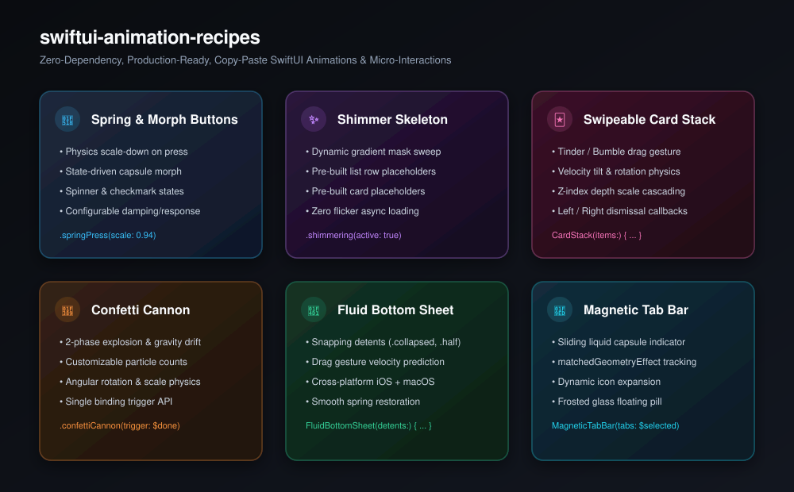

# swiftui-animation-recipes

[](https://github.com/nilkanthdesai76/swiftui-animation-recipes/actions/workflows/ci.yml)
[](https://swift.org)
[](https://developer.apple.com)
[](LICENSE)

A curated, copy-paste ready collection of production-grade, zero-dependency SwiftUI animations and interactive micro-components. Take what you need, drop it straight into your SwiftUI app, and customize with zero bloat.

<p align="center">
  
</p>

---

## ⚡ Included Recipes

| Recipe | Description | Style / Technique | File |
| :--- | :--- | :--- | :--- |
| **Spring Button** | Physics-based scale bounce on user touch. | `.buttonStyle(.springPress)` | [`SpringButtons.swift`](Sources/SwiftUIAnimationRecipes/Buttons/SpringButtons.swift) |
| **Morphing Button** | Capsule transforms into spinner on click, then checkmark on success. | Shape animation + state machine | [`SpringButtons.swift`](Sources/SwiftUIAnimationRecipes/Buttons/SpringButtons.swift) |
| **Shimmer Skeleton** | Async loading placeholder with linear gradient mask sweep. | ViewModifier + LinearGradient | [`ShimmerSkeleton.swift`](Sources/SwiftUIAnimationRecipes/Loading/ShimmerSkeleton.swift) |
| **Card Stack Swipe** | Tinder/Bumble card stack with drag gestures, rotation tilt, and z-index cascading. | DragGesture + Spring Physics | [`CardStack.swift`](Sources/SwiftUIAnimationRecipes/Cards/CardStack.swift) |
| **Confetti Cannon** | 2-phase explosion and gravity drift celebration particles. | Offset math + opacity decay | [`ConfettiCannon.swift`](Sources/SwiftUIAnimationRecipes/Particles/ConfettiCannon.swift) |
| **Fluid Bottom Sheet** | Draggable sheet with velocity snapping detents (`.collapsed`, `.half`, `.expanded`). | DragGesture + Detents | [`FluidBottomSheet.swift`](Sources/SwiftUIAnimationRecipes/Sheets/FluidBottomSheet.swift) |
| **Magnetic Tab Bar** | Floating frosted capsule with sliding indicator using matched geometry. | `matchedGeometryEffect` | [`MagneticTabBar.swift`](Sources/SwiftUIAnimationRecipes/Navigation/MagneticTabBar.swift) |

---

## 📦 Installation

Either copy-paste any single file directly into your Xcode project (zero dependencies), or add the package via SPM:

```swift
dependencies: [
    .package(url: "https://github.com/nilkanthdesai76/swiftui-animation-recipes.git", from: "1.0.0")
]
```

---

## 🚀 Quick Examples

### 1. Physics Spring Press Button

```swift
Button("Place Order") {
    // action
}
.buttonStyle(.springPress(scale: 0.94, response: 0.28, dampingFraction: 0.6))
```

### 2. Shimmer Skeleton Loading

```swift
// Apply to any shape or layout
RoundedRectangle(cornerRadius: 8)
    .frame(height: 20)
    .shimmering(active: isLoading)

// Or use the pre-built skeleton rows
SkeletonListRow(showAvatar: true)
SkeletonCard(height: 220)
```

### 3. Confetti Cannon Trigger

```swift
@State private var showConfetti = false

Button("Complete Goal") {
    showConfetti = true
}
.confettiCannon(trigger: $showConfetti, count: 60)
```

### 4. Interactive Card Stack

```swift
CardStack(items: profiles) { profile in
    ProfileCardView(profile: profile)
} onSwipe: { profile, direction in
    print("Swiped \(direction) on \(profile.name)")
}
```

### 5. Floating Magnetic Tab Bar

```swift
@State private var activeTab = "home"

MagneticTabBar(
    tabs: [
        TabItem(id: "home", title: "Home", icon: "house.fill"),
        TabItem(id: "search", title: "Search", icon: "magnifyingglass"),
        TabItem(id: "settings", title: "Settings", icon: "gearshape.fill")
    ],
    selectedTab: $activeTab
)
```

---

## 📄 License

This repository is licensed under the [MIT License](LICENSE).
